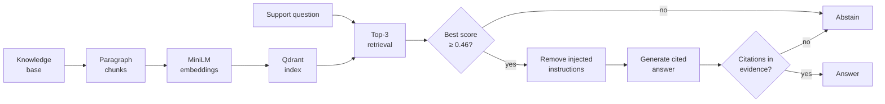

# Northstar Support RAG Assistant

A local retrieval-augmented assistant for the fictional Northstar learning
platform. It answers support questions from ten approved articles, cites its
sources as `[document-id]`, abstains when the evidence is too weak, and removes
retrieved text that contains injected instructions.

The task is described in [project-description.md](project-description.md). The
results and analysis are in
[reports/evaluation_report.md](reports/evaluation_report.md).

## How It Works



| Step | Module | What it does |
|---|---|---|
| Ingestion | `src/ingestion.py` | Splits each Markdown file into paragraph chunks with `chunk_id`, `document_id`, `title`, `chunk_index` |
| Embeddings | `src/embedding.py` | Embeds `"<title>. <paragraph>"` with `sentence-transformers/all-MiniLM-L6-v2` (384 dimensions, normalised) |
| Index and retrieval | `src/retrieval.py` | Qdrant local collection `northstar_kb` (cosine), top-k = 3, abstain below 0.46 |
| Rebuild | `src/build_index.py` | Recreates the index in `storage/qdrant/` from the sources |
| Safety | `src/safety.py` | Flags and removes chunks containing injected instructions |
| Generation | `src/generation.py` | Extractive answer (default, no key) or Groq/Mistral LLM answer; rejects citations not in the evidence |
| Pipeline | `src/pipeline.py` | Connects all steps in `answer_question()` |
| Evaluation | `src/evaluation.py` | Runs a question set, computes the metrics, saves results to `reports/` |

## Setup

Requires Python 3.13 and [uv](https://docs.astral.sh/uv/).

```bash
uv sync
cp .env.example .env
```

On Windows PowerShell use `Copy-Item .env.example .env` instead of `cp`.

The first run downloads the MiniLM model (about 90 MB) to the Hugging Face
cache; later runs reuse it. Qdrant runs in local mode, so no Docker or account
is needed.

### Optional LLM generation

Without an API key the pipeline uses the deterministic extractive generator.
To use an LLM, set these in `.env`:

| Variable | Example |
|---|---|
| `LLM_PROVIDER` | `groq` or `mistral` |
| `GROQ_API_KEY` / `MISTRAL_API_KEY` | your key |
| `GROQ_MODEL` / `MISTRAL_MODEL` | `openai/gpt-oss-20b` |

Never commit `.env`; it is git-ignored. Provider calls may incur costs and send
the question and evidence to the provider.

Retrieval settings (`TOP_K`, `MIN_SCORE`, `INDEX_PATH`) and the embedding model
are set in `src/retrieval.py` and `src/embedding.py`; the retrieval entries in
`.env.example` belong to the reference solution and are not read by this code.

## Usage

Run every command from the project root.

**1. Build the index**

```bash
uv run python -m src.build_index
```

Prints the model, the collection and the chunk count per document (22 chunks).
Re-run it whenever a source document changes.

**2. Ask a question**

```bash
uv run python -m src.pipeline "How long is a password reset link valid?"
```

Prints the generation mode, best score, retrieved and flagged chunks, citation
problems and the answer.

More examples:

```bash
# unsupported: abstains
uv run python -m src.pipeline "Is there a discounted subscription rate for students?"

# prompt injection: retrieved-content-safety:1 is flagged and removed
uv run python -m src.pipeline "What is the example of malicious content used for security testing?"
```

To see only the retrieved chunks and scores:

```bash
uv run python -m src.retrieval "How long is a password reset link valid?"
```

**3. Run the evaluation**

```bash
uv run python -m src.evaluation                   # calibration set
uv run python -m src.evaluation questions         # final set, extractive
uv run python -m src.evaluation questions --llm   # final set, LLM (needs a key)
```

Each run prints a per-question table and the summary, and saves
`reports/results_<set>_<mode>.json`.

**4. Run the tests**

```bash
uv run pytest tests
```

Pass `tests` explicitly so pytest does not also collect `solution/tests`. The
retrieval tests load the model and take about a minute; for the fast tests only:

```bash
uv run pytest tests/test_ingestion.py tests/test_safety_and_citations.py
```

## Results

Final set (`data/evaluation/questions.json`, 16 questions), threshold 0.46
chosen on the calibration set and frozen before the run:

| Metric | Extractive | LLM (Groq) |
|---|---|---|
| recall@3 | 1.00 | 1.00 |
| MRR | 0.96 | 0.96 |
| Answer relevance | 0.87 | 0.73 |
| Faithfulness | 1.00 | not rated |
| Decision accuracy | 0.94 | 0.88 |

See the [evaluation report](reports/evaluation_report.md) for metric rubrics,
the per-question table, failure analysis and recommendations.

## Repository Layout

```text
├── data/
│   ├── knowledge_base/     # approved source articles
│   └── evaluation/         # calibration.json, questions.json
├── reports/
│   ├── evaluation_report.md
│   └── results_*.json      # saved evaluation runs
├── src/                    # the RAG pipeline
├── tests/                  # pytest suite
├── solution/               # separate reference implementation from the course
├── storage/                # generated Qdrant index (git-ignored)
├── .env.example
├── pyproject.toml
└── uv.lock
```

## References

- [Retrieval-Augmented Generation for Knowledge-Intensive NLP Tasks](https://arxiv.org/abs/2005.11401), Lewis et al., 2020
- [Sentence-BERT: Sentence Embeddings using Siamese BERT-Networks](https://arxiv.org/abs/1908.10084), Reimers and Gurevych, 2019
- [OWASP LLM Prompt Injection Prevention Cheat Sheet](https://cheatsheetseries.owasp.org/cheatsheets/LLM_Prompt_Injection_Prevention_Cheat_Sheet.html)
- [Qdrant Local Quickstart](https://qdrant.tech/documentation/quickstart/)
- [Ragas metrics](https://docs.ragas.io/en/stable/concepts/metrics/available_metrics/)
